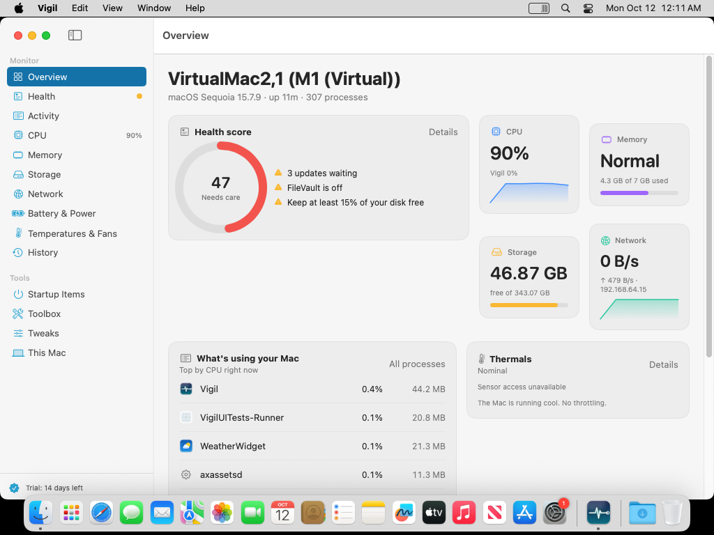

# Vigil

**Your Mac, explained.** A native macOS menu bar app and dashboard that watches everything (CPU, memory, storage, network, battery, temperatures and fans), remembers what used them, scores your Mac's health with fixes that make it last longer, cleans up safely, and exposes the settings macOS hides.

> Activity Monitor tells you *that* `mds_stores` is at 180%. Vigil tells you it is Spotlight re-indexing after your last big copy, that it will settle in about an hour, and what to do if it does not.



## Why people pay for it

| Question people actually ask | Vigil's answer |
|---|---|
| Why is my Mac slow *right now*? | The menu bar popover shows the top offenders with a plain-English explanation and a **safe-to-quit verdict** for 200+ macOS, browser and developer processes. |
| What was using my RAM at 3 pm when it froze? | **History**: every metric recorded every 10 s, top processes once a minute, kept for 90 days in SQLite. Drag across any chart to see what was running at that moment. |
| Is my Mac healthy? Will it last? | A **health score** (100 minus explainable penalties) across storage, memory, thermals, battery, security and backups, each finding paired with a concrete action. Plus the longevity habits that matter: 20–80% charging, 15% disk headroom, heat, restarts, backups. |
| What is eating my disk? | **Storage** measures 30+ reclaimable categories (caches, logs, Xcode, simulators, Homebrew/npm/pip, Docker, iOS backups, old downloads…), shows exactly what it will remove, deletes only caches outright and moves *your* files to the Trash. |
| What starts at login? | **Startup Items**: login items, launch agents and daemons with vendor, status and one-click disable. |
| Is it too hot? | Every readable SMC temperature grouped by CPU/GPU/battery/storage, fan RPM, macOS thermal state, and power draw. |
| Can I change the hidden stuff? | **Tweaks**: 70+ `defaults` settings (Finder, Dock, screenshots, key repeat, trackpad, windows, clock…) as switches with one-click revert. |
| OneMenu-style utilities? | **Toolbox**: keep awake, keyboard-cleaning lock, screen-cleaning mode, free memory, flush DNS, renew DHCP, relaunch Finder/Dock/menu bar, hide desktop icons, show hidden files, dark mode, lock, sleep, eject all, rebuild Spotlight, fix "Open With", reset Launchpad, clear font caches, reset Bluetooth/audio, maintenance scripts. |

Everything is local. No account, no analytics, no server. The one network request (public IP lookup) is off by default.

## Free vs Pro

Live monitoring, the process explainer, the health score, 24 hours of history, the cleaning modes and non-admin toolbox actions are **free forever**. **Vigil Pro** (14-day trial, then a yearly or lifetime licence) unlocks clean-up, tweaks, startup-item control, history beyond 24 hours and the administrator tools (purge, Spotlight rebuild, snapshots, font cache, maintenance scripts).

Licences are offline Ed25519-signed keys (`VIGIL-<payload>.<signature>`), so the app never phones home to check. See *Issuing licences* below.

## Requirements and distribution

- macOS 14 Sonoma or later, Apple Silicon or Intel.
- Not sandboxed (it reads the SMC, all processes, launch agents and other apps' caches), so it ships **outside the Mac App Store** with Developer ID signing and notarization. `.github/workflows/macos-release.yml` does that and produces a DMG.
- Permissions are all optional and requested only when a feature needs them: Full Disk Access (Mail/Safari/Trash/iOS backup sizes), Accessibility (global keyboard lock), Notifications, Location (Wi-Fi network name on macOS 14+), Automation (login items, Dark Mode, Empty Trash). Admin actions use the standard macOS password prompt.

## Project layout

```
Vigil/
├── Vigil.xcodeproj            # Xcode 16 project, file-system-synchronised groups, 3 targets
├── Vigil/
│   ├── App/                   # VigilApp (MenuBarExtra + Window + Settings scenes), AppState, AppSettings
│   ├── Models/                # Metric samples, history points, health findings, dashboard sections
│   ├── Probes/                # Low-level readers: CPU (Mach), Memory (vm_statistics64), Disk (IOKit + volumes),
│   │                          #   Network (getifaddrs, CoreWLAN, SCDynamicStore), Battery (AppleSmartBattery + IOPS),
│   │                          #   SMC (temperatures, fans, power; keys discovered at runtime), GPU (IOAccelerator),
│   │                          #   Processes (libproc rusage v4), SystemInfo (sysctl, IOKit, tmutil, fdesetup…), Peripherals
│   ├── Services/              # MetricsEngine (sampling loop), HistoryStore (SQLite), HealthEngine (rules),
│   │                          #   ProcessDictionary, StorageScanner + CleanupService, StartupItemsService,
│   │                          #   TweakCatalog + TweaksService (CFPreferences), Toolbox, KeepAwake, CleaningModes,
│   │                          #   NotificationService, LicenseManager (CryptoKit), EventRecorder, Permissions, MenuBarRenderer
│   ├── Views/                 # SwiftUI: MenuBar popover, Dashboard shell, one folder per section, Settings, Onboarding
│   ├── Utilities/             # Sysctl, IORegistry helpers, Shell (incl. privileged runs), Format, Theme
│   ├── Assets.xcassets        # App icon, accent colour
│   ├── Info.plist, Vigil.entitlements
├── VigilTests/                # XCTest: health rules, licensing, history store, formatters, catalogs, SMC decoding, probe smoke tests
├── VigilUITests/              # XCUITest that walks every dashboard page and attaches screenshots (CI commits them)
├── Tools/make-license.swift   # keygen / issue / verify licence keys
└── docs/RESEARCH.md           # User study, competitive teardown, feature list, non-goals
```

### Architecture notes

- **Sampling.** `MetricsEngine` (`@MainActor @Observable`) runs one `Task` loop. Each tick runs every probe on a detached utility task and publishes the results on the main actor; the UI observes the engine directly. The default interval is 2 s; the cost of a tick is measured and shown in Settings (target: under 1 % of one core).
- **Probes are plain classes with no dependencies.** Each keeps the previous counters it needs to compute deltas (CPU ticks, disk/network bytes, per-process CPU time). `SMCProbe` enumerates every SMC key once, keeps the `T*` keys that return plausible temperatures, and groups them by prefix, so it works across Intel and every Apple Silicon generation without a hard-coded table.
- **History.** `HistoryStore` is a thin SQLite3 wrapper on a serial queue: `samples` (every 10 s, pruned by retention), `process_samples` (top 12 once a minute, 14 days), `events` (app launches/quits, sleep/wake, thermal and pressure changes, clean-ups, tweaks). Charts query averaged buckets so a 30-day range is still a few hundred points.
- **Health.** `HealthEngine.evaluate(context:)` is a pure function over a `HealthContext`, so every rule is unit-testable and the score is explainable: 100 minus 25/10/3 per critical/warning/tip.
- **Cleanup safety.** Categories carry a risk level and a method: caches and logs are deleted in place, user files (downloads, backups, archives) are moved to the Trash with `FileManager.trashItem`, and a few run a system command (`tmutil`, `simctl`, `docker`). Nothing is removed without a confirmation that lists what happens to each category.
- **Tweaks** go through `CFPreferences` (what the `defaults` tool uses) and relaunch Finder/Dock/SystemUIServer when needed. Reset deletes the key so macOS's default applies.
- **Privileged actions** run `do shell script … with administrator privileges` through `NSAppleScript`, which shows the system password dialog; nothing is stored.

## Building and running

1. Open `Vigil/Vigil.xcodeproj` in Xcode 16 or newer.
2. Select the `Vigil` target → Signing & Capabilities → choose your team (bundle id `com.faisalrizwan.vigil`).
3. Run. The dashboard opens on first launch; afterwards Vigil lives in the menu bar (click the icon, ⌘D opens the dashboard). Launch with `-dashboard` to force the window.
4. ⌘U runs the unit tests. The UI test target walks every page and attaches screenshots.

CI (`.github/workflows/macos.yml`) builds and tests on a macOS runner on every pull request that touches `Vigil/`, and commits the screenshots it captures to `Vigil/Screenshots/`.

## Launching

`docs/LAUNCH.md` walks through Developer ID signing, notarization, licence keys, selling direct, updates and the hardware validation checklist. Settings → General → *Save report to Desktop* (or `open -a Vigil --args -diagnostics`) writes every raw reading to `~/Desktop/Vigil-diagnostics.txt` for that validation.

## Issuing licences

```
swift Tools/make-license.swift keygen
# private: <keep secret>   public: <paste into LicenseVerifier.productionPublicKeyHex>
swift Tools/make-license.swift issue <private-hex> customer@example.com lifetime
swift Tools/make-license.swift verify <public-hex> VIGIL-…
```

The production public key is embedded; the private key lives only with the owner and in the fulfilment worker's secrets. `Tools/fulfilment/` is a Cloudflare Worker that turns Lemon Squeezy orders into keys automatically.

## Known limitations

- Fan *control* and battery charge *limiting* are deliberately out of scope: both need a privileged helper or SMC writes. Vigil reads only.
- The Wi-Fi network name is hidden by macOS 14+ until Location access is granted; signal, channel and rate still show.
- Login items are read through System Events (Automation permission). Launch daemons are shown read-only.
- `Temperature` keys vary by machine; a few Macs expose none. The macOS thermal state is always available.
- Per-process network usage is not exposed by public APIs; network is shown per interface.
